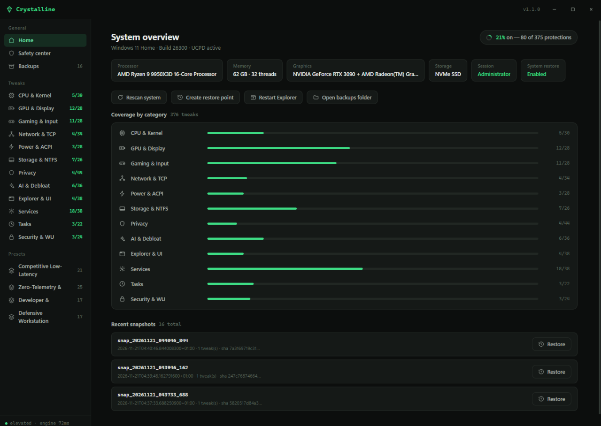

# Crystalline — Windows 11 Tweaks, Optimizer & Debloat Tool

**Crystalline** is a fast, safety-first Windows tweaker for Windows 10 & 11. It ships **376 verified Windows tweaks** — registry tweaks, services, scheduled tasks, power and network optimization, privacy/telemetry controls, gaming performance tuning, and bloatware removal — and unlike typical Windows optimizer scripts, every change is **scanned live, dry-runnable, snapshotted, and revertible**.

Built with a **Rust native engine** (parallel registry/service/task scanning in ~100ms) and an **Electron** frontend. No fake "boost" entries — every tweak maps to a real Windows setting with a live before/after state.




---

## Features

- **376 real Windows tweaks across 12 categories** — CPU & kernel scheduling, GPU & display, gaming & input latency, network & TCP, power & ACPI, storage & NTFS, privacy & telemetry, AI & debloat, Explorer & UI, services, scheduled tasks, and security & Windows Update.
- **Live state detection** — each tweak is classified on every scan: `applied`, `default`, `near-match` (a custom variant already set, e.g. a different `Win32PrioritySeparation`), `partial-drift` (half-reset by Windows Update), `hazardous` (toxic value from a bad optimizer pack), or `incompatible` (wrong hardware/OS).
- **Dry-run before/after diff** on every tweak — see exactly which registry value, service mode, or setting will change before anything is written.
- **Safety Center** — one-click Windows restore point, SHA-256-verified snapshots, emergency WinRE `.reg`/`.cmd` rollback files, and a healer that repairs 9 known toxic tweaks left behind by other "optimizer" tools.
- **Atomic rollback** — if a multi-part tweak partially fails, applied steps are rolled back automatically.
- **Hardware-aware gating** — laptop battery guard, SSD vs HDD detection (no defrag/Trim breakage), RAM floor, and peripheral checks (printer, Bluetooth, Xbox, touchscreen) so irrelevant tweaks are locked out instead of breaking things.
- **Preset banks** — Balanced, Gaming, Privacy, and Maximum presets that apply curated subsets.
- **Search + per-category toggles** — filter all 376 tweaks instantly, toggle per category.

## Why not just run a `.bat` tweak pack?

Most Windows tweak scripts (`.bat`/`.reg` dumps) apply values blindly. Crystalline instead:

1. **Reads the live state first** — it won't stomp a setting you've already customized.
2. **Blocks known-dangerous values** at the engine level (e.g. `WaitToKillServiceTimeout` < 1500ms, HID queue sizes < 16, disabled SSD TRIM, `TcpAutoTuning=disabled`, CPU mitigation overrides, `useplatformclock` BCD edits, protected services).
3. **Snapshots before every apply** and verifies every write by reading it back — catching silent blocks like Windows 11's `UCPD.sys` write interception.
4. **Self-heals restore points** — enables System Restore, starts `VSS`/`swprv`/`srservice`, and clears block policies before creating the checkpoint, then restores your policies.

## Download

Grab the latest portable build from [**Releases**](../../releases) — unzip and run `Crystalline.exe`. No installer, no admin needed to *scan* (admin is only required to apply system-level tweaks; the app offers "Relaunch as Admin" in the header).

> **Note:** The binary is unsigned, so SmartScreen may warn once — click **More info → Run anyway**. This is normal for unsigned open-source tools. The source is fully auditable below.

## Run from source

Requires [Node.js](https://nodejs.org) (18+) and optionally [Rust](https://rustup.rs) if you want to rebuild the engine (a prebuilt `native-engine/crystalline-engine.exe` is included).

```bash
git clone https://github.com/<you>/crystalline.git
cd crystalline
npm install
npm start
```

### Rebuild the engine (optional)

```bash
cd native-engine
cargo build --release
copy target\release\crystalline-engine.exe .
cd ..
npm start
```

### Build the portable package

```bash
npm run pack   # produces dist/Crystalline-win32-x64
```

## How it works

```
renderer/        Electron UI — dark toggle cards, search, presets, dry-run diff, Safety Center
electron/        main process + preload bridge (contextIsolation on, nodeIntegration off)
native-engine/   Rust JSON-RPC engine over stdio — scanner, executor, snapshot vault,
                 safety firewall, hardware probes (winreg + Win32 FFI + rayon)
tweaks/          376-tweak catalog, generated + schema-validated by build_catalog.js
```

- The renderer talks to a persistent Rust process over newline-delimited JSON-RPC.
- Scanning reads the registry directly and parses the Task Cache raw — no hundreds of PowerShell spawns — so a full 376-target sweep lands in roughly **75–130ms**.
- Snapshots live in `%APPDATA%\Crystalline\backups` (outside the app folder) with SHA-256 integrity checks.

## Safety notes & disclaimer

- Every apply is preceded by a snapshot; revert restores the exact previous bytes (or deletes the value if it didn't exist).
- Emergency `.reg` and `.cmd` files are written per snapshot so you can roll back even from WinRE if the app won't boot.
- That said: this tool edits real system settings. Read the dry-run diff, keep the restore point on, and use it at your own risk. If something looks off, open **Safety Center → Restore snapshot**.

## FAQ

**Does it work on Windows 10?** Most tweaks apply to both 10 and 11; build-gated tweaks are marked incompatible automatically.

**Will it break Windows Update?** The Security/Update category has optional update controls — defaults are conservative, and service-based changes are fully revertible.

**Is it a virus?** No. Tweak tools get flagged because they write system registry keys — same reason Cheat Engine and W10Privacy do. The full source is in this repo; build it yourself if you prefer.

**Where are my backups?** `%APPDATA%\Crystalline\backups` — JSON snapshots plus `emergency/` `.reg` + `.cmd` files.

## Contributing

The tweak catalog is data-driven — new tweaks are added in `tweaks/modules/*.js` following the existing schema (id, category, impact, risk, evidence, apply/revert ops). Run `node tweaks/build_catalog.js` to validate and regenerate `catalog.json`. PRs for new verified tweaks, better hardware gates, or translations are welcome.

## License

MIT — see [LICENSE](LICENSE).

---

**Keywords:** windows tweaks, windows 11 tweaks, windows tweaker, windows optimizer, windows 11 optimizer, debloat windows, disable telemetry windows, registry tweaks, gaming performance tweaks windows, lower input latency, windows privacy tool, network optimization windows, windows services optimization, revertible windows tweaks, rust windows tool, electron windows app
